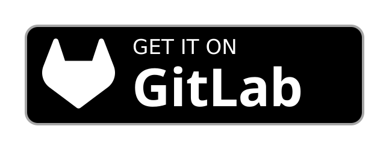

# MasterClock

> [!WARNING]
> For transparency: this project is developed with the help of AI (Claude Code). Review the code accordingly before relying on it.

> [!NOTE]
> The app is still in testing. Expect bugs, and please report anything you run into.

A chess clock app for chess, wargames, and tabletop games. Handles classic time controls as well as more complex multi-phase formats (Omni mode).

<a href="https://github.com/UsernameAlreadyTakenSHT/MasterClock/releases/latest"></a>
<a href="https://gitlab.com/UsernameAlreadyTakenSHT/masterclock/-/releases"></a>
<a href="https://apps.obtainium.imranr.dev/redirect.html?r=obtainium%3A%2F%2Fadd%2Fhttps%3A%2F%2Fgithub.com%2FUsernameAlreadyTakenSHT%2FMasterClock"></a>

**Contents:** [Features](#features) · [Flavors](#flavors) · [Translations](#translations) · [Privacy](#privacy) · [Building](#building) · [Verifying a release](#verifying-a-release) · [Credits & Licensing](#credits--licensing)

## Features

Fourteen timing modes, each described in the [reference](docs/reference/modes.md):

| Mode | Variants |
|---|---|
| Sudden Death | |
| Bonus | Fischer, Bronstein, US Delay |
| Move Timer | Standard, Save & Cap, Overtime, Global, Shared (Auto), Global Shared |
| Byoyomi | Japanese, Canadian, Progressive |
| Hourglass | |
| Chronos | Countdown, Countup |
| Move Counts | Count Up, Count Down |
| Gong | |
| FIDE Periods | |
| Phases | |
| Random | |
| Hidden | |
| Fast Move | Accelerate, Transfer |
| Staircase | Down, Up |

The Complete build adds a notebook, a scoreboard, the game logs and statistics, games of chance (coin,
dice, short straw, card), rulebooks, sharing and backup of settings, and a reset of everything.

Four build flavors (Complete, Standard, Lite, Mini), plus a dedicated E-Ink version built with
Mudita's own [MMD](https://github.com/mudita/MMD) component library. MasterClock is an independent
project, not affiliated with Mudita.

Requires Android 7.0 (API 24) or later. Every screen and option is described in the
[reference](docs/reference/README.md).

## Flavors

| | Complete | Standard | Lite | Mini | E-Ink |
|---|---|---|---|---|---|
| Modes settings | ✅ | ✅ | ✅ | ✅ (3 modes) | ✅ (3 modes) |
| Behavior / Display / Audio settings | ✅ | ✅ | ❌ | ❌ | ❌ |
| More (tools, backup, notebook…) | ✅ | ❌ | ❌ | ❌ | ❌ |
| Presets | ✅ | ✅ | ✅ | ❌ | ❌ |
| Arbiter's panel | ✅ | ✅ | ✅ | ❌ | ❌ |

"3 modes" means Sudden Death, Fischer, and Move Timer Standard only — everything else supports the full set of timing modes.

## Translations

The app is in **English, French, Spanish, German, Italian, Portuguese** — in both its European and
Brazilian forms — **and Dutch**. All but the French are unreviewed by a native speaker, so
corrections are especially welcome, and are the easiest contribution to make: the files are plain
XML and you do not need to build the app. See **[TRANSLATING.md](TRANSLATING.md)**, which also
covers adding a language that is not listed yet.

Partial translations are useful: Android falls back string by string, so ten translated lines are
ten lines in your language and the rest stay English. See **[TRANSLATING.md](TRANSLATING.md)**.

On Android 13 and later the language can be picked per app, under
Settings › Apps › MasterClock › Language.

## Privacy

MasterClock collects nothing: no analytics, no ads, no trackers, and no network access at all.
Settings, game logs and notebook entries stay on the device. The
[privacy policy](https://usernamealreadytakensht.github.io/masterclock-website/) says what each
runtime permission is for and when it is asked for.

## Building

JDK 21 and the Android SDK are all it takes; the Gradle wrapper fetches the rest.

```sh
./gradlew :app:assembleCompleteRelease   # or Standard, Lite, Mini
./gradlew :paper:assembleRelease         # the E-Ink app
./gradlew :core:test                     # the unit tests
```

Without a signing key the release APKs come out unsigned. [AGENTS.md](AGENTS.md) describes the
modules, how the flavors differ and the full set of checks a change has to pass, and
[TRANSLATING.md](TRANSLATING.md) and [RELEASING.md](RELEASING.md) cover those two jobs.

## Verifying a release

Releases ship a `SHA256SUMS.txt` beside the APKs, and tags from v0.8.24 on are GPG-signed with the
key in [`docs/signing-key.asc`](docs/signing-key.asc) — fingerprint
`210B 5FD0 0E17 66BB 8797  3EDC A286 94BC BC91 9301`. [docs/VERIFYING.md](docs/VERIFYING.md) explains
what each check proves and what it does not.

## Credits & Licensing

- **Logo icon**: clock icon from [Tabler Icons](https://tabler.io/icons) by Paweł Kuna (v3.44.0), MIT License.
- **Chess pieces**: "Cburnett" style, from [Wikimedia Commons](https://commons.wikimedia.org/wiki/Category:SVG_chess_pieces), by [Cburnett](https://en.wikipedia.org/wiki/User:Cburnett/GFDL_images/Chess). GFDL and CC BY-SA 3.0.
- **Draughts stones**: by [Antonsusi](https://commons.wikimedia.org/wiki/User:Antonsusi), from [Wikimedia Commons](https://commons.wikimedia.org/wiki/Category:SVG_Draughts_pieces). Public domain — too simple a shape to carry copyright.
- **Emojis** (Complete, in text notes and on drawings): [OpenMoji](https://openmoji.org/) 17.0 by the HfG Schwäbisch Gmünd, [CC BY-SA 4.0](https://creativecommons.org/licenses/by-sa/4.0/). The bundled color font is reduced to the Unicode emojis, the OpenMoji-only extras left out. The drawings a sticker is made from are OpenMoji's own SVG files, unchanged but for their names, for the emojis a note offers.
- **Audio**: four sounds from [Pixabay](https://pixabay.com/), used under the [Pixabay Content License](https://pixabay.com/service/terms/). It allows their use in an app; it is not a free licence, which is why the F-Droid entries carry the `NonFreeAssets` label.
  - Gong: [Zen Gong – Alex_Jauk](https://pixabay.com/sound-effects/film-special-effects-zen-gong-199844/)
  - Beep: [Beep – u_edtmwfwu7c](https://pixabay.com/sound-effects/film-special-effects-beep-329314/)
  - Final beep: [Public Domain Beep Sound – qubodup](https://pixabay.com/sound-effects/public-domain-beep-sound-100267/)
  - Switch: [Light Switch – RutgerMuller (Freesound)](https://pixabay.com/sound-effects/film-special-effects-light-switch-82388/)
- **Font**: [Lato](https://www.latofonts.com/) by Łukasz Dziedzic, [SIL Open Font License 1.1](https://openfontlicense.org/). Bundled by the E-Ink build, through MMD.
- **E-Ink interface**: built with [Mudita Mindful Design (MMD)](https://github.com/mudita/MMD), Mudita's component library for its E Ink devices.

### Rules documents

The Complete build bundles these rulebooks so they can be read offline from the "Some rules" screen. Each remains the property of its author or publisher; credit below is the attribution carried by the document itself. If you hold rights to one of these and would like it removed, open an issue and it will be taken out.

- **Chess** — Laws of Chess, [FIDE](https://www.fide.com/), compiled by Alex Holowczak.
- **Draughts (international)** — FMJD Annexes 2024, [Fédération Mondiale du Jeu de Dames](https://www.fmjd.org/), by Ada Dorgelo, Frank Teer and Jacek Pawlicki.
- **Draughts (64)** — Official Rules of the Game, [International Draughts Federation](https://idf64.org/).
- **Shogi** — FESA Rules, [Federation of European Shogi Associations](https://fesashogi.eu/).
- **Nine Men's Morris** — the game is in the public domain; the rulebook and "Stacking Morris" are © 2022 Kanare Kato.
- **Tafl** — Historical Hnefatafl rules, [World Tafl Federation](https://aagenielsen.dk/).

### Open-source licenses

Also listed in-app under the version footer → Licenses tab.

| Library | Copyright | License |
|---|---|---|
| [AndroidX / Jetpack Compose](https://developer.android.com/jetpack) | The Android Open Source Project | Apache-2.0 |
| [Kotlin & kotlinx](https://github.com/JetBrains/kotlin) | JetBrains s.r.o. and Kotlin contributors | Apache-2.0 |
| [Material Components for Android](https://github.com/material-components/material-components-android) | Google LLC | Apache-2.0 |
| [Mudita Mindful Design (MMD)](https://github.com/mudita/MMD) | Mudita Sp. z o.o., The Android Open Source Project | Apache-2.0 |
| [Coil](https://github.com/coil-kt/coil) | Coil Contributors | Apache-2.0 |
| [Accompanist](https://github.com/google/accompanist) (Drawable Painter, Permissions) | Google LLC | Apache-2.0 |
| [AndroidSVG](https://github.com/BigBadaboom/androidsvg) | Paul LeBeau | Apache-2.0 |
| [Okio](https://square.github.io/okio/) | Square, Inc. | Apache-2.0 |
| [ZXing Core](https://github.com/zxing/zxing) | ZXing Authors | Apache-2.0 |
| [Guava](https://github.com/google/guava) | The Guava Authors | Apache-2.0 |
| [Dagger](https://github.com/google/dagger) | Google LLC | Apache-2.0 |
| [javax.inject (JSR-330)](https://github.com/javax-inject/javax-inject) | The JSR-330 Expert Group | Apache-2.0 |

Only the first three ship in every build. MMD ships in the E-Ink build alone, which is the only
one that links it. Everything below it reaches Complete alone: R8 strips each one from Standard,
Lite, Mini and E-Ink, none of which ever call it. The last three arrive
through CameraX and amount to a handful of classes, but they are shipped and so are credited.

Project licensed under the MIT License.
